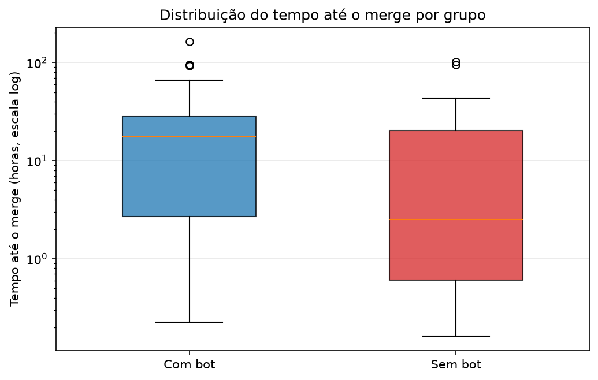
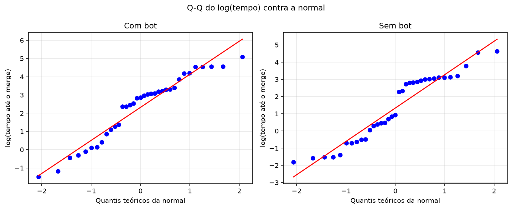

# Análise exploratória dos dados reais

> Relatório gerado por `python -m src.analise_exploratoria` em 05/11/2026 11:08.
> Amostra: [`data/prs_merge_time.csv`](../data/prs_merge_time.csv) — 35 PRs com review de bot e 35 sem.
> Metodologia da coleta: [`data/README.md`](../data/README.md).

## 1. Amostra

A amostra tem 70 pull requests mergeados do repositório
`supabase/supabase`, coletados em 2026-11-05: 35 no grupo
`com_bot` e 35 no grupo `sem_bot`. O tempo até o merge é
medido em horas, de `created_at` até `merged_at`.

## 2. Estatísticas descritivas

| Grupo | n | Média (h) | Mediana (h) | DP (h) | Mín. (h) | Q1 (h) | Q3 (h) | Máx. (h) | CV | Assimetria | Curtose |
|---|---:|---:|---:|---:|---:|---:|---:|---:|---:|---:|---:|
| `com_bot` | 35 | 29,53 | 17,56 | 37,88 | 0,23 | 2,68 | 28,64 | 162,93 | 1,28 | 1,87 | 3,50 |
| `sem_bot` | 35 | 14,75 | 2,52 | 23,52 | 0,16 | 0,61 | 20,17 | 102,16 | 1,59 | 2,80 | 8,38 |

Os dois grupos são fortemente assimétricos à direita: a média fica bem acima
da mediana e o máximo é muito maior que o Q3. O grupo `com_bot` tem mediana e
média maiores que o `sem_bot`.

## 3. Assimetria e outliers

Outliers pelo critério de 1,5 × IQR:

- `com_bot` (5): PR #52493 (162,93 h), PR #52506 (94,91 h), PR #52558 (94,69 h), PR #52513 (93,98 h), PR #52563 (93,01 h)
- `sem_bot` (2): PR #52545 (102,16 h), PR #52534 (95,21 h)

A distribuição não é um bloco único: em `com_bot`, 10 dos
35 PRs mergearam em menos de 3 h e 23
levaram mais de 10 h. Em `sem_bot`, 18 dos
35 mergearam em menos de 3 h e 16 levaram
mais de 10 h. Ou seja, há um grupo de merges rápidos e outro de merges
lentos, o que uma distribuição unimodal só consegue aproximar.

## 4. Normalidade e homocedasticidade

| Grupo | Shapiro bruto (p) | Shapiro no log (p) | D'Agostino no log (p) |
|---|---:|---:|---:|
| `com_bot` | 2,1e-06 | 0,0424 | 0,2126 |
| `sem_bot` | 2,1e-08 | 0,0103 | 0,0040 |

A normalidade é rejeitada na escala bruta nos dois grupos. A transformação log
melhora muito o ajuste, mas `sem_bot` ainda é rejeitado por Shapiro e por
D'Agostino no nível de 5%. Levene entre os grupos: p = 0,1099
na escala bruta e p = 0,2178 no log — não há evidência
forte de variâncias desiguais.

## 5. Comparação de distribuições

| Grupo | Distribuição | AIC | KS (p) | Parâmetros |
|---|---|---|---:|---|
| `com_bot` | lognormal | 305,8 | 0,2477 | μ=2,32, σ=1,77 |
| `com_bot` | gamma | 302,4 | 0,8505 | k=0,58, θ=50,75 |
| `com_bot` | weibull | 302,4 | 0,8750 | k=0,70, λ=23,47 |
| `sem_bot` | lognormal | 241,9 | 0,1171 | μ=1,33, σ=1,92 |
| `sem_bot` | gamma | 244,0 | 0,1906 | k=0,47, θ=31,31 |
| `sem_bot` | weibull | 242,7 | 0,2984 | k=0,60, λ=9,70 |

As três distribuições têm AIC próximo e nenhuma é rejeitada pelo KS em
qualquer um dos grupos. Em `sem_bot`, lognormal e Weibull são equivalentes na
prática.
Optamos pela **lognormal** por ter interpretação direta (mediana e σ), ser a
distribuição sugerida no enunciado e permitir representar o efeito como um
deslocamento em `mu`. Gamma e Weibull ficam registradas como sensibilidade.

## 6. Parâmetros da simulação

Ajuste por máxima verossimilhança de uma lognormal com loc fixo em zero.
`mediana = exp(mu)` e `média = exp(mu + sigma²/2)`.

| Grupo | μ | σ | Mediana ajustada (h) | Mediana amostral (h) | Média ajustada (h) | DP ajustado (h) | n |
|---|---:|---:|---:|---:|---:|---:|---:|
| `com_bot` | 2,3188 | 1,7743 | 10,16 | 17,56 | 49,05 | 231,58 | 35 |
| `sem_bot` | 1,3297 | 1,9166 | 3,78 | 2,52 | 23,72 | 146,98 | 35 |

Os parâmetros estão em [`src/parametros.py`](../src/parametros.py). A mediana
ajustada não coincide com a mediana amostral: em `com_bot` fica abaixo
(10,16 h contra 17,56 h) e em `sem_bot` fica acima (3,78 h contra 2,52 h). A
mediana ajustada é `exp(mu)`, isto é, a média geométrica, que não é o mesmo
estimador da mediana amostral; com n = 35 e cauda longa, os dois podem divergir
bastante. O modelo deve ser lido como uma aproximação da distribuição, não como
uma réplica exata das estatísticas amostrais.

## 7. Tamanho do efeito observado

- `delta_mu = mu_com_bot - mu_sem_bot = 0,9891`
- razão das médias geométricas: **2,69×**
- razão das medianas amostrais: **6,97×**
- d de Cohen na escala log: **0,53**

A razão das medianas amostrais é maior que a razão das médias geométricas
porque as medianas de amostras pequenas e muito assimétricas são instáveis.
O valor `delta_mu` é o parâmetro mais adequado para alimentar a simulação.

## 8. Como a simulação vai usar esses parâmetros

- **H₀ (sem efeito):** os dois grupos são gerados com os parâmetros do grupo
  de controle `sem_bot`.
- **H₁ (com efeito):** o grupo tratado usa `mu + delta_mu`, mantendo σ; assim
  a mediana e a média são multiplicadas por `exp(delta_mu)`.
- **Grade sugerida:** `(0.0, 0.25, 0.5, 0.75, 1.0, 1.25, 1.5, 2.0)`.
- O tamanho amostral principal deve ser `n = 35` por grupo, igual ao estudo
  real; a #9 pode variar `n` nas simulações de violação de pressupostos.

## 9. Justificativa

1. O tempo até o merge é positivo e contínuo, com cauda à direita — a
   lognormal é uma escolha natural e é a distribuição exemplificada no
   enunciado.
2. O teste KS não rejeita a lognormal em nenhum dos grupos, embora o ajuste
   não seja perfeito.
3. A mediana é uma medida central robusta para dados assimétricos; σ captura
   a dispersão na escala log.
4. Usamos o grupo `sem_bot` como controle porque a pergunta é se a review de
   bot muda o tempo de merge; em H₀, ambos os grupos vêm dessa distribuição.
5. Mantivemos os outliers no ajuste para que a simulação preserve a
   assimetria observada; a #9/Q3 explora cenários com violações mais severas.

## 10. Limitações

- **Bimodalidade:** os dados têm um bloco de merges rápidos e outro de lentos;
  uma lognormal unimodal é uma aproximação.
- **Cauda simulada:** o q99 ajustado é 630,42 h em
  `com_bot` e 326,50 h em `sem_bot`, contra
  139,81 h e 99,80 h observados. A
  simulação pode produzir outliers mais extremos que os reais.
- **Confundidor de tamanho:** a mediana de linhas alteradas é
  111 em `com_bot` contra
  31 em `sem_bot`, e a mediana de reviews
  humanas é 2 contra
  1. Parte da diferença de tempo pode vir
  do tamanho e do processo de revisão, não do bot.
- **Amostra pequena e de um único repositório/bot**, sem atribuição aleatória
  da review. Os resultados não são generalizáveis.
- **Apenas PRs mergeados** entram na amostra (viés de sobrevivência).

## 11. Figuras diagnósticas

